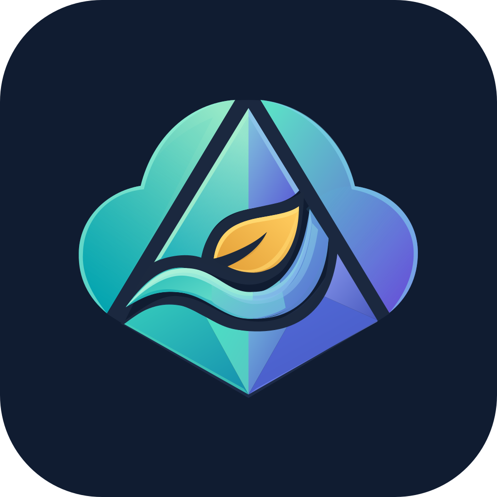

<div align="center">
  
  <br />
  
  <h1>Drive Therapy (<code>v2.2.0</code>)</h1>
  <p><strong>An accessible, non-destructive, local-first studio for managing Google Workspace, Google Drive, Google Photos/Takeout, and personal media with greater calm, clarity, and security.</strong></p>
  <p>
    <a href="docs/wiki/Home.md"><strong>Wiki</strong></a> ·
    <a href="docs/FAQ.md"><strong>FAQ</strong></a> ·
    <a href="docs/PRODUCTION_OAUTH_GUIDE.md"><strong>Google OAuth Verification Guide</strong></a> ·
    <a href="docs/PRIVACY_POLICY.md"><strong>Privacy Policy</strong></a> ·
    <a href="docs/TERMS_OF_SERVICE.md"><strong>Terms of Service</strong></a> ·
    <a href="SECURITY.md"><strong>Security Policy</strong></a> ·
    <a href="CONTRIBUTING.md"><strong>Contributing</strong></a> ·
    <a href="CHANGELOG.md"><strong>Changelog</strong></a> ·
    <a href="LICENSE"><strong>AGPL-3.0-or-later</strong></a> ·
    <a href="NOTICE"><strong>Creator Notice</strong></a>
  </p>
</div>

---

## 1. Mission Statement & Creator's Note

**Drive Therapy** was created to give people an easier, calmer, more accessible, and more secure way to manage their **Google Workspaces** (Google Drive, Google Photos/Takeout, and cloud media) alongside their local files.

- **Why Drive Therapy Exists**: Standard cloud dashboards can feel overwhelming, visually fatiguing, and opaque when organizing thousands of documents, photos, audio files, or Takeout archives. Drive Therapy brings high-speed keyboard/Vim curation, 52 sensory-friendly themes (including High-Contrast AAA and Warm Low-Glare Dyslexia presets), 20 languages, and local-first security utilities into one non-destructive workspace.
- **Forthright Authorship & Claims**: Conceived, architected, assistd and directed by its creator to solve real-world Google Workspace and personal media management challenges, built through iterative human-directed, human-coded (CSS, React, TypeScript) and AI-assisted engineering. We believe in being 100% forthright about what runs out-of-the-box versus what connects to external services using your own credentials (see the **Honest Capabilities Matrix** below).

---

## 2. Honest Capabilities Matrix (What Runs Offline vs. With Your Credentials)

| Capability Area | How It Works in Practice | Credentials Needed |
| :--- | :--- | :--- |
| **9 Studio Views, Non-Destructive Curation & Offline Vision (`src/workers/vision.worker.ts`)** | All 9 Studios (File Manager, Culling Room, Pixel Editor, AI Vision Lab, Portfolio Maker, Slideshow Theater, World Map, Music/Media Studio, Cloud Power Suite), IndexedDB cataloging (`drive_therapy_catalog_v2`), EXIF parsing, 64-bit perceptual dHash burst/duplicate grouping, Canvas/WebGL LUT color grading, XMP sidecar export, and tokenized batch renaming/exporting run **100% locally**. Original files are never altered without explicit `DestructiveActionDialog` confirmation. | **None (100% Offline)** |
| **Google Workspace, Google Drive v3 & Concurrent Multi-Account Vault (`server/security/sessionVault.ts`)** | Connects to your real Google Workspace / Google Drive accounts via OAuth 2.0 PKCE. Stores tokens in a server-side **AES-256-GCM encrypted vault (`.session-vault.enc`)** bound to an `HttpOnly` cookie (`dt_sid` — zero raw OAuth tokens in `localStorage`). Supports concurrent multi-account switching and HTTP 206 byte-range media streaming (`/api/drive/stream/:fileId`). | **Your Google OAuth Client ID & Secret** ([Setup Guide](docs/PRODUCTION_OAUTH_GUIDE.md)) |
| **Local Host Filesystem & Google Takeout Inspector (`/api/fs/*`, `/api/takeout/*`)** | Browses local folders and inspects local Google Takeout `.zip`/`.tgz` or extracted archives. Strictly restricted to requests originating from your local machine via `isLoopbackRequest(req)`. | **None (Loopback Only)** |
| **Client-Side Zero-Knowledge Vault, CDC Delta Sync & CRDT Conflict Solver (`src/services/cloudPowerSuiteEngine.ts`)** | Encrypts sensitive payloads in-browser with WebCrypto `PBKDF2-SHA256` (`210,000` iterations) + `AES-256-GCM`; computes content-defined chunking (CDC) delta diffs and resolves multi-device edit conflicts with deterministic vector clocks. | **None (100% Local)** |
| **Hero Links (`/s/:slug`), Unified DLP, Clean PDF Prep & OpenSharing v1 (`server/routes/heroLinks.ts`, `openSharing.ts`)** | Generates one persistent canonical `/s/:slug` link per asset stored locally in mode-`0600` `.hero-links-store.json`, evaluates sensitivity + audience DLP rules before sharing, strips EXIF/GPS metadata for printable share packets, and serves Delta Sharing v1 JSON endpoints (`/api/opensharing/*`). | **None (Self-Hosted / Local Instance)** |
| **4-Tier Privacy-First Malware Scanner (`server/routes/malwareScanner.ts`)** | **Tier 0** runs 100% offline in memory (SHA-256, EICAR, PE/ELF/Mach-O executable extension spoofing, PDF `/JavaScript`, SVG `<script>` checks — **never uploads your files**). **Tier 1** queries MalwareBazaar/URLhaus (or optional VirusTotal/MetaDefender/Sophos Intelix) by hash/URL only. **Tier 2** sandboxes require explicit opt-in consent. **Tier 3** automatically uses local ClamAV (`clamscan`) if installed on your OS. | **None for Tier 0, MalwareBazaar, URLhaus & Local ClamAV**; BYO API key for commercial Tier 1/2 feeds |
| **15 External Cloud Connector Adapters (`/api/clouds/*`)** | Provides local protocol adapters, capability matrices, `rclone`/FUSE/WebDAV mount command builders, and transfer workflow registries for S3, R2, B2, Dropbox, OneDrive, Box, Nextcloud, Proton Drive, MEGA, SFTP, etc. | **BYO Provider Credentials / Local Mounts** for live external cloud transfers |
| **Gemini AI Semantic Tagging & Assistant (`/api/gemini/*`)** | Optional cloud AI enrichment and natural-language queries; automatically falls back to offline `vision.worker.ts` heuristics and local `tesseract.js` OCR when no key is configured. | **Optional `GEMINI_API_KEY`** |

---

## 3. Supported Platforms & Prerequisites

| Platform | Supported Environments | Build Output / Package Format |
| :--- | :--- | :--- |
| **Windows 10 / 11 (`x64`)** | Native Win32/PE32+, Electron, or Node.js | `DriveTherapy.exe` (standalone native executable), `DriveTherapy.bat`, Electron NSIS installer & Portable `.exe` |
| **Linux (`x86_64`)** | GNOME, KDE Plasma, Hyprland, Sway, i3, XFCE, Cinnamon, MATE (X11 & Wayland) | `DriveTherapy-linux-x64` (native ELF binary), `DriveTherapy.sh`, Electron `AppImage` & `.deb` |
| **macOS (`arm64` & `x64`)** | macOS 13+ (Apple Silicon M1–M4 & Intel) | `DriveTherapy-macos-arm64`, `DriveTherapy-macos-x64`, `DriveTherapy.command`, Electron `.dmg` & `.zip` |
| **Android (`arm64-v8a` / WebView)** | Android 8.0+ (API 26–34), Termux / ADB | `android/` Gradle WebView Studio project (`com.drivetherapy.studio`), `DriveTherapy-android-arm64` binary, PWA / TWA |
| **Web / PWA** | Chrome / Edge / Brave `>= 120`, Firefox `>= 120`, Safari `>= 17.4` | Responsive SPA + Offline Service Worker (`public/sw.js`) + Window Controls Overlay (`public/manifest.json`) |

---

## 4. Quick Start (Development & Local Production Server)

```bash
# 1. Install dependencies (Node.js >= 22 required)
npm install

# 2. Configure optional environment variables (100% functional offline without API keys)
cp .env.example .env

# 3. Run in development mode
npm run dev

# 4. Build and start the production server (auto-selects a clean port 3010+, excluding 3009)
npm run build
npm start
```

---

## 5. Building & Packaging for All Supported Operating Systems

### A. Universal Portable Bundle & Native Standalone Executables (Windows `.exe`, Linux, macOS, Android)

Compiles the web studio (`dist/`), bundles the Express backend (`dist-portable/server.cjs`), cross-compiles **5 native standalone executables** from [`native-launcher/main.go`](native-launcher/main.go), and packages portable `.zip` and `.tar.gz` archives in `release/`:

```bash
npm run build:portable-bundle
```

- **Windows 10/11 (`x64`)**: `dist-portable/DriveTherapy.exe` (double-click to run; boots `server.cjs` if Node.js is installed, or runs its built-in zero-dependency native HTTP server if Node.js is absent)
- **Linux (`x86_64`)**: `./dist-portable/DriveTherapy-linux-x64`
- **macOS (`arm64` & `x64`)**: `./dist-portable/DriveTherapy-macos-arm64` or `DriveTherapy.command`
- **Android (`arm64`)**: `./dist-portable/DriveTherapy-android-arm64`
- **Universal Archives**: `release/DriveTherapy-v2.2.0-universal-portable.zip`, `.tar.gz`, and `release/SHA256SUMS.txt`

### B. Desktop Electron Installers (Windows, Linux X11/Wayland/Tiling WMs, macOS)

```bash
# Linux (AppImage & .deb with automatic GNOME/KDE/Hyprland/Sway/i3/XFCE window frame negotiation)
npm run build:electron:linux

# Windows 10/11 (NSIS Installer & Portable .exe with native titleBarOverlay)
npm run build:electron:win

# macOS (.dmg & .zip with hiddenInset traffic-light controls)
npm run build:electron:mac
```

### C. Android Build (`com.drivetherapy.studio`)

```bash
# 1. Build web bundle and synchronize the native Android Gradle project (android/)
npm run build:android

# 2. Open android/ in Android Studio OR compile the APK via Gradle with Android SDK 34:
cd android && gradle assembleDebug

# 3. Install onto a connected Android device via ADB:
adb install -r app/build/outputs/apk/debug/app-debug.apk
```

---

## 6. Verification, Quality Assurance & Documentation

| Command | Description |
| :--- | :--- |
| `npm run lint` | TypeScript strict type-checking and Erasable Syntax verification (`tsc --noEmit`). |
| `npm test` | Execute all `479+` automated unit, integration, contract, property, fuzz, security, and lifecycle tests. |
| `npm audit --audit-level=high` | Verify `0` high or critical supply-chain vulnerabilities. |
| `npm run qa:e2e` | Execute live HTTP, 6 security headers, sprite path-traversal guard, and API contract smoke checks. |
| `npm run qa:release-audit` | Generate CycloneDX 1.5 SBOM (`docs/release-readiness/sbom.cdx.json`) and 23-phase release readiness dossier (`docs/release-readiness/00..22`). |

### Documentation Directory
- **GitHub Wiki**: [`docs/wiki/Home.md`](docs/wiki/Home.md) ([01 Installation & OS Builds](docs/wiki/01-Installation-and-OS-Builds.md) · [02 Studios & Shortcuts](docs/wiki/02-Studios-and-Keyboard-Shortcuts.md) · [03 Cloud Power Suite](docs/wiki/03-Cloud-Power-Suite-and-Multicloud.md) · [04 Hero Links, DLP & Malware Scanner](docs/wiki/04-Enterprise-Sharing-DLP-and-Malware-Scanning.md) · [05 Troubleshooting](docs/wiki/05-FAQ-and-Troubleshooting.md))
- **Frequently Asked Questions**: [`docs/FAQ.md`](docs/FAQ.md)
- **Google OAuth Setup Guide**: [`docs/PRODUCTION_OAUTH_GUIDE.md`](docs/PRODUCTION_OAUTH_GUIDE.md)
- **User Flow & Indexing Guides**: [`docs/USER_FLOW_GUIDE.md`](docs/USER_FLOW_GUIDE.md) · [`docs/INDEXING_PROCESS_GUIDE.md`](docs/INDEXING_PROCESS_GUIDE.md)
- **Security Policy & Architecture**: [`SECURITY.md`](SECURITY.md)
- **Contributing Guide & Changelog**: [`CONTRIBUTING.md`](CONTRIBUTING.md) · [`CHANGELOG.md`](CHANGELOG.md)
- **23-Phase Release Readiness Dossier & SBOM**: [`docs/release-readiness/22-executive-summary.md`](docs/release-readiness/22-executive-summary.md) · [`docs/release-readiness/sbom.cdx.json`](docs/release-readiness/sbom.cdx.json)
