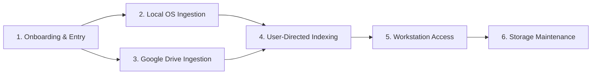

# Drive Therapy: Complete User Flow & UX Architecture Guide

**Document Version:** 1.0.0  
**Companion File:** [`docs/user_flow.graphml`](file:///home/face/Documents/Documents/code/drivetherapy/docs/user_flow.graphml) (38 Nodes, 49 Directed Edges)  
**Target Release:** v2.7.0  

---

## 1. Overview & Visualizer Compatibility

The [`docs/user_flow.graphml`](file:///home/face/Documents/Documents/code/drivetherapy/docs/user_flow.graphml) file provides a formal, standards-compliant graph model of Drive Therapy's end-to-end user experience. It maps every user gesture, browser decision gate, state transition, and background process across both cloud and local storage tiers.

### How to View and Edit the GraphML File:
1. **Draw.io / diagrams.net**: Go to File &rarr; Import From &rarr; Device &rarr; select `docs/user_flow.graphml`.
2. **yEd Graph Editor**: Open directly with yEd (free desktop editor) for automatic orthogonal or hierarchical layout (`Layout` &rarr; `Hierarchical`).
3. **Gephi / Cytoscape**: Open as a directed network graph for cluster and dependency analysis.

---

## 2. The 6 Core Clusters & UX Feasibility Analysis

---

### Cluster 1: Onboarding & Entry
- **Component**: [`src/components/OnboardingHeroGate.tsx`](file:///home/face/Documents/Documents/code/drivetherapy/src/components/OnboardingHeroGate.tsx)
- **UX Goal**: Zero dummy data, immediate visual clarity, and multiple zero-barrier entry points.
- **Feasibility Verification**:
  - **Returning Users**: If assets exist in IndexedDB (`loadAssets()`), the app bypasses onboarding in $<100\text{ms}$ and renders the catalog without auto-triggering network scans.
  - **First-Time Users**: Presented with 1-click Google Sign-In, 1-click Local OS Folder Mount, and a pre-loaded Sample Shoot playground.
  - **Power Users**: Direct links to the 4-step `OAuthWizardModal` and `AuthDiagnosticsModal`.

---

### Cluster 2: Local OS Storage Ingestion
- **Component**: [`src/services/localFileSystem.ts`](file:///home/face/Documents/Documents/code/drivetherapy/src/services/localFileSystem.ts)
- **UX Goal**: Non-destructive, direct in-place access with 0 bytes uploaded to any server.
- **Feasibility Verification**:
  - **Chromium / Edge**: Uses `window.showDirectoryPicker()` to open the native OS folder dialog. Retains `FileSystemDirectoryHandle` in IndexedDB `meta` store for cross-session reconnection.
  - **Firefox / Sandboxes**: Automatically falls back to `<input webkitdirectory>` and multi-file picker. A persistent pre-flight note clarifies: *"Firefox prompts 'Upload' as standard browser nomenclature for local in-memory directory reading (0MB sent to any server)"*.
  - **Drag-and-Drop**: Users can drop entire folder hierarchies anywhere on the window. An ambient HUD (`<HardDrive>` icon) confirms zero-upload in-place mounting.
  - **Memory Safety**: `BlobMemoryRegistry` tracks every generated `blob:` URL so memory is freed on dismount.

---

### Cluster 3: Google Drive Cloud Ingestion
- **Component**: [`src/services/googleDrive.ts`](file:///home/face/Documents/Documents/code/drivetherapy/src/services/googleDrive.ts), [`server.ts`](file:///home/face/Documents/Documents/code/drivetherapy/server.ts)
- **UX Goal**: Frictionless OAuth 2.0 without popup suppression or iframe clickjacking blocks.
- **Feasibility Verification**:
  - **Direct Server PKCE**: `/api/auth/google/login` launches synchronously in response to the user's click gesture, eliminating browser popup suppression.
  - **Iframe Failover**: If embedded in an iframe that triggers `X-Frame-Options: DENY`, the app automatically opens [`StandaloneAuthWindow.tsx`](file:///home/face/Documents/Documents/code/drivetherapy/src/components/StandaloneAuthWindow.tsx) in a top-level tab.
  - **Cross-Window Sync**: Token broadcasts simultaneously across `BroadcastChannel('drive_therapy_auth')`, `localStorage`, and `postMessage`. `lastSyncedTokenRef` deduplicates events to prevent duplicate auth dispatches.
  - **Storage Telemetry**: Real quota is inspected via `drive.about.get` and rendered in the sidebar storage donut.

---

### Cluster 4: User-Directed Dual-Tier Indexing
- **Component**: [`src/App.tsx`](file:///home/face/Documents/Documents/code/drivetherapy/src/App.tsx), [`src/components/FloatingSyncDrawer.tsx`](file:///home/face/Documents/Documents/code/drivetherapy/src/components/FloatingSyncDrawer.tsx)
- **UX Goal**: User is always in full control of network and CPU load. Zero unwanted background sweeps.
- **Feasibility Verification**:
  - **Quick Scan (Latest 300)**: Queries folder hierarchy with `pageSize=1000` (1 request instead of 10) and files with `pageSize=300` and `orderBy=modifiedTime desc`. Employs progressive batch streaming in 50-file chunks so photos appear instantly on screen ($<2\text{s}$).
  - **Deep Scan (Entire Drive)**: Unbounded loop with `maxItems=0` sweeps all folders across multi-terabyte drives. Real-time counter: *"Deep indexing: 2,450 files scanned..."*.
  - **Targeted Folder Sweep**: Selecting any folder displays `[ ↻ Index "${folder.name}" Only ]` for single-folder queries (`'${folderId}' in parents`).
  - **Instant Cancellation**: The user can click `[ Cancel ]` on any running task in `FloatingSyncDrawer` to abort via `AbortController`.

---

### Cluster 5: Workstation Access & Creative Modes
- **Components**:
  - [`src/components/FileManagerView.tsx`](file:///home/face/Documents/Documents/code/drivetherapy/src/components/FileManagerView.tsx): 6-category filter ribbon, search omnibox, responsive grid/list, EXIF loupe.
  - [`src/components/CullingRoomView.tsx`](file:///home/face/Documents/Documents/code/drivetherapy/src/components/CullingRoomView.tsx): Hotkeys `1-5` (ratings), `P` (pick), `X` (reject), `Space` (loupe), `C` (dual-split sharpness comparison), `6-9` (color labels).
  - [`src/components/AiVisionLabView.tsx`](file:///home/face/Documents/Documents/code/drivetherapy/src/components/AiVisionLabView.tsx): In-browser smart crop, focal box saliency, and multi-provider vision inference.
  - [`src/components/PixelEditorView.tsx`](file:///home/face/Documents/Documents/code/drivetherapy/src/components/PixelEditorView.tsx): 8 calibrated film presets, Rule of Thirds crop, live RGB histogram, and real Canvas blob exporter.
  - [`src/components/PortfolioMakerView.tsx`](file:///home/face/Documents/Documents/code/drivetherapy/src/components/PortfolioMakerView.tsx): Watermarked client proofing gallery with standalone offline HTML export.
  - [`src/components/SlideshowTheaterView.tsx`](file:///home/face/Documents/Documents/code/drivetherapy/src/components/SlideshowTheaterView.tsx): Ken Burns ambient motion and dual-screen synchronization via `BroadcastChannel`.

---

### Cluster 6: Storage Dismount & Zero-Ghost Maintenance
- **Components**: [`src/services/storageJanitor.ts`](file:///home/face/Documents/Documents/code/drivetherapy/src/services/storageJanitor.ts), [`src/components/StorageSettingsModal.tsx`](file:///home/face/Documents/Documents/code/drivetherapy/src/components/StorageSettingsModal.tsx)
- **UX Goal**: Mounting, dismounting, and running the app never leaves ghost files, memory leaks, or unrevoked blobs.
- **Feasibility Verification**:
  - **Local Folder Dismount**: Clicking the hover `Trash2` eject button next to any local folder immediately revokes all associated `blob:` URLs from browser heap memory, removes directory handles, and deletes assets from IndexedDB.
  - **Cloud Sign Out**: Purges all `source === 'cloud'` records from IndexedDB so disconnecting never leaks ghost assets into subsequent sessions.
  - **Storage Settings Panel**: Real-time `navigator.storage.estimate()` visual gauge, itemized record counts, and granular purge options.
  - **1-Click Atomic Factory Reset**: High-contrast `[ ⚡ Flush All Storage & Reset ]` button atomically wipes IndexedDB, drops heap blobs, clears tokens, and flushes CacheStorage.

---

## 3. Node Inventory in `docs/user_flow.graphml`

| Node ID | Element Label | Type | Primary Component |
|---|---|---|---|
| `N_ENTRY` | App Boot / Arrival | `system_process` | `src/App.tsx` |
| `N_SESSION_GATE` | Session Hydrated? | `decision_gate` | `src/App.tsx` |
| `N_ONBOARDING_GATE` | Onboarding Hero Gate | `ui_view` | `src/components/OnboardingHeroGate.tsx` |
| `N_SAMPLE_SHOOT` | Load Sample Shoot | `user_action` | `src/services/demoCatalog.ts` |
| `N_OAUTH_WIZARD` | OAuth Setup Wizard | `ui_view` | `src/components/OAuthWizardModal.tsx` |
| `N_AUTH_DIAGNOSTICS` | Auth Diagnostics & Direct Token | `ui_view` | `src/components/AuthDiagnosticsModal.tsx` |
| `N_MOUNT_LOCAL_TRIGGER` | Mount Local Folder Trigger | `user_action` | `StorageSidebar.tsx`, `App.tsx` (DragOverlay) |
| `N_BROWSER_FS_GATE` | File System Access API Supported? | `decision_gate` | `src/services/localFileSystem.ts` |
| `N_NATIVE_DIR_PICKER` | Native Directory Picker | `system_process` | `localFileSystem.ts (openLocalDirectory)` |
| `N_FIREFOX_FALLBACK` | Webkitdirectory / Multi-File Fallback | `system_process` | `localFileSystem.ts (openLocalFiles)` |
| `N_BLOB_REGISTRY` | Blob Memory Registry | `storage_state` | `localFileSystem.ts (BlobMemoryRegistry)` |
| `N_LOCAL_MOUNTED_STATE` | Local Folder Mounted (0MB Upload) | `storage_state` | `StorageSidebar.tsx`, `catalogDb.ts` |
| `N_SIGNIN_TRIGGER` | Sign in with Google Trigger | `user_action` | `OnboardingHeroGate.tsx`, `CentralOmnibox.tsx` |
| `N_FRAME_CONTEXT_GATE` | Framed or Top-Level Window? | `decision_gate` | `src/services/googleDrive.ts` |
| `N_DIRECT_SERVER_PKCE` | Direct Server PKCE | `system_process` | `server.ts`, `googleDrive.ts` |
| `N_STANDALONE_FAILOVER` | Standalone Top-Level Failover | `ui_view` | `src/components/StandaloneAuthWindow.tsx` |
| `N_AUTH_SYNC` | Cross-Window Auth Sync | `system_process` | `src/App.tsx (handleSyncAuthToken)` |
| `N_DRIVE_CONNECTED_STATE` | Google Drive Connected & Quota Ready | `storage_state` | `StorageSidebar.tsx`, `StorageMetricCards.tsx` |
| `N_SCAN_CHOICE_GATE` | Choose Indexing Tier | `decision_gate` | `StorageSidebar.tsx`, `FileManagerView.tsx` |
| `N_QUICK_SCAN_ACTION` | Quick Scan (Latest 300) | `user_action` | `src/App.tsx (handleQuickScan)` |
| `N_DEEP_SCAN_ACTION` | Deep Scan (Entire Drive) | `user_action` | `src/App.tsx (handleDeepScan)` |
| `N_TARGET_FOLDER_ACTION` | Index Active Folder Only | `user_action` | `FileManagerView.tsx (handleIndexActiveFolder)` |
| `N_SCAN_MUTEX` | Concurrency Mutex & AbortController | `system_process` | `src/App.tsx (handleScanDrive, handleCancelScan)` |
| `N_BATCH_STREAMER` | Progressive 50-Item Batch Streamer | `system_process` | `googleDrive.ts (fetchDriveFiles onBatchReceived)` |
| `N_BURST_AND_STORE` | Burst Clustering & IndexedDB Storage | `storage_state` | `burstDetection.ts`, `catalogDb.ts` |
| `N_MODE_SELECTION_GATE` | Select Workstation Mode | `decision_gate` | `src/components/MiniDock.tsx` |
| `N_VIEW_CATALOG` | Media Catalog View (Files Mode) | `ui_view` | `src/components/FileManagerView.tsx` |
| `N_VIEW_CULLING` | Culling Room (Photo Mechanic) | `ui_view` | `src/components/CullingRoomView.tsx` |
| `N_VIEW_VISION` | AI Vision Lab | `ui_view` | `src/components/AiVisionLabView.tsx` |
| `N_VIEW_EDITOR` | Pixel Editor (Darkroom Studio) | `ui_view` | `src/components/PixelEditorView.tsx` |
| `N_VIEW_PORTFOLIO` | Portfolio Maker (Client Proofing) | `ui_view` | `src/components/PortfolioMakerView.tsx` |
| `N_VIEW_SLIDESHOW` | Slideshow Theater & Presenter | `ui_view` | `SlideshowTheaterView.tsx`, `PresenterWindow.tsx` |
| `N_ASSET_INSPECTOR` | Activity Timeline & EXIF Inspector | `ui_view` | `src/components/ActivityTimelineDrawer.tsx` |
| `N_DISMOUNT_LOCAL` | Eject / Dismount Local Folder | `user_action` | `StorageSidebar.tsx`, `localFileSystem.ts` |
| `N_CLOUD_DISCONNECT` | Google Drive Disconnect (Sign Out) | `user_action` | `App.tsx (handleSignOut)`, `catalogDb.ts` |
| `N_STORAGE_SETTINGS_MODAL`| Storage & Cache Settings Panel | `ui_view` | `src/components/StorageSettingsModal.tsx` |
| `N_SMART_CLEANUP` | Smart Ghost Cleanup | `system_process` | `storageJanitor.ts (performSmartCleanup)` |
| `N_FACTORY_FLUSH` | 1-Click Flush All (Factory Reset) | `user_action` | `storageJanitor.ts (flushAllStorage)` |
