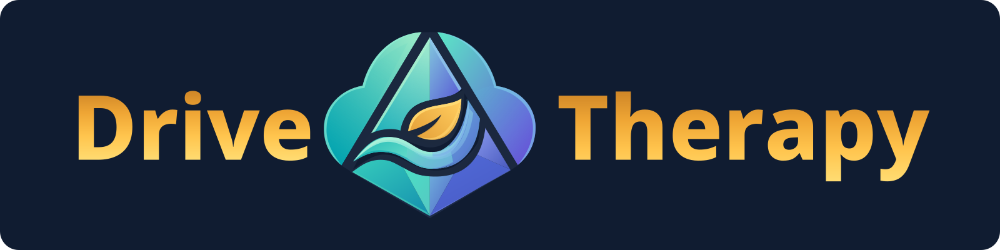
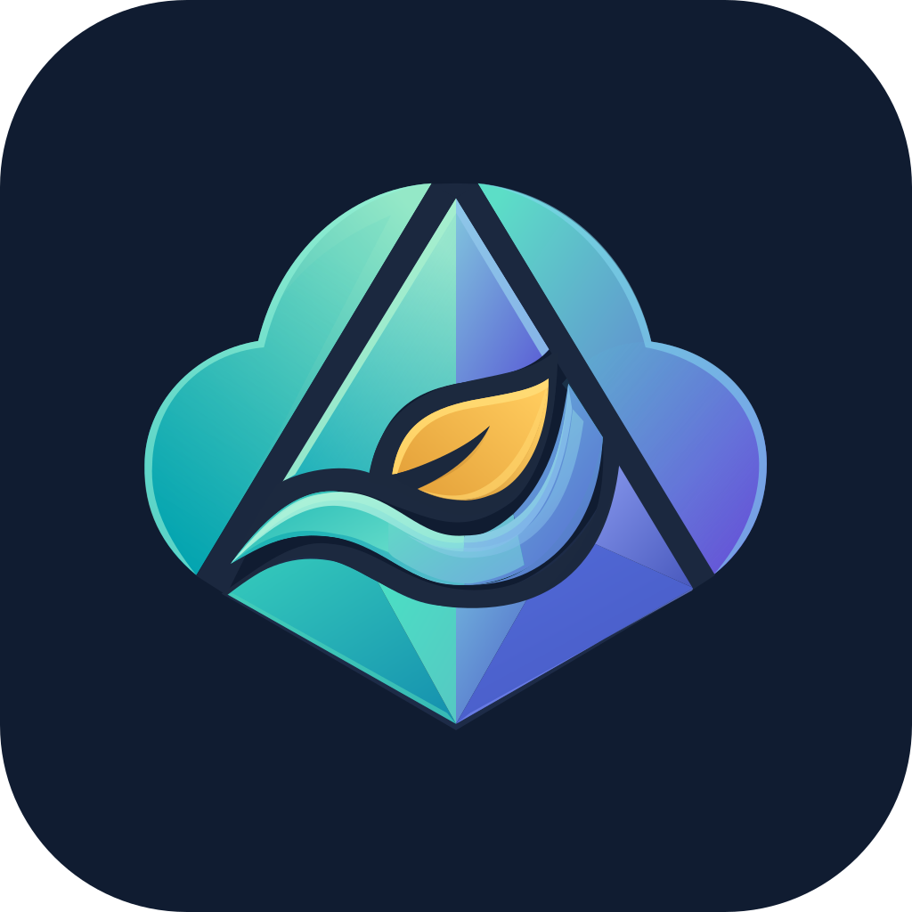

  
   
  
  <h1>Drive Therapy Wiki (v2.2.0)</h1>
  
<strong>An accessible, non-destructive, local-first studio for managing Google Workspace, Google Drive, Google Photos/Takeout, and personal media with greater calm, clarity, and security.</strong>

---

## Our Mission & Creator's Note

**Drive Therapy** was created to help people easily manage their Google Workspaces and personal files while making the experience genuinely **more accessible** and **more secure**.

- **Why "Therapy"?** Managing thousands of disorganized cloud documents, photos, audio tracks, and Google Takeout archives in standard web dashboards is often stressful and visually exhausting. Drive Therapy replaces cluttered interfaces with 9 purpose-built creative and organizational studios, 52 sensory-aware themes (including High-Contrast AAA and Warm Low-Glare Dyslexia presets), full keyboard/Vim navigation, and strict **non-destructive integrity** (never altering your original files without explicit confirmation).
- **Forthright Engineering & Authorship**: Conceived, architected, and directed by its creator to solve real-world Google Workspace and media curation challenges through human-guided, AI-assisted engineering. Every claim in this Wiki is grounded in verifiable code and automated tests (`479+` passing tests across `110` suites).

---

## Wiki Chapters

1. **[01 — Installation & Cross-OS Build Guide](01-Installation-and-OS-Builds.md)**
   - Prebuilt Native Executables (`DriveTherapy.exe`, `DriveTherapy-linux-x64`, `DriveTherapy-macos-arm64`, `DriveTherapy-android-arm64`)
   - Universal Portable Bundle (`.zip` / `.tar.gz`)
   - Desktop Electron Packages (Windows, Linux X11/Wayland/Tiling WMs, macOS)
   - Android Studio / Gradle APK Build (`com.drivetherapy.studio`)
2. **[02 — The 9 Studios, Accessibility & Keyboard/Vim Shortcuts](02-Studios-and-Keyboard-Shortcuts.md)**
   - Tour of all 9 Studio views, Culling Room hotkeys, Vim procedural navigation, 52 themes, and 20 languages.
3. **[03 — Cloud Power Suite, Zero-Knowledge Vault & Multicloud](03-Cloud-Power-Suite-and-Multicloud.md)**
   - Client-side WebCrypto AES-256-GCM Vault, Content-Defined Chunking (CDC) Delta Sync, CRDT Vector-Clock Conflict Resolution, and external cloud adapters.
4. **[04 — Persistent Hero Links, Unified DLP, OpenSharing & 4-Tier Malware Scanner](04-Enterprise-Sharing-DLP-and-Malware-Scanning.md)**
   - Canonical `/s/:slug` Hero Links, sensitivity/audience DLP rules, Clean PDF Prep, Databricks OpenSharing v1, and privacy-first Tier 0–3 file scanning.
5. **[05 — Frequently Asked Questions & Troubleshooting](05-FAQ-and-Troubleshooting.md)**
   - Honest answers on offline mode, OAuth setup, credential storage, and common troubleshooting steps.
